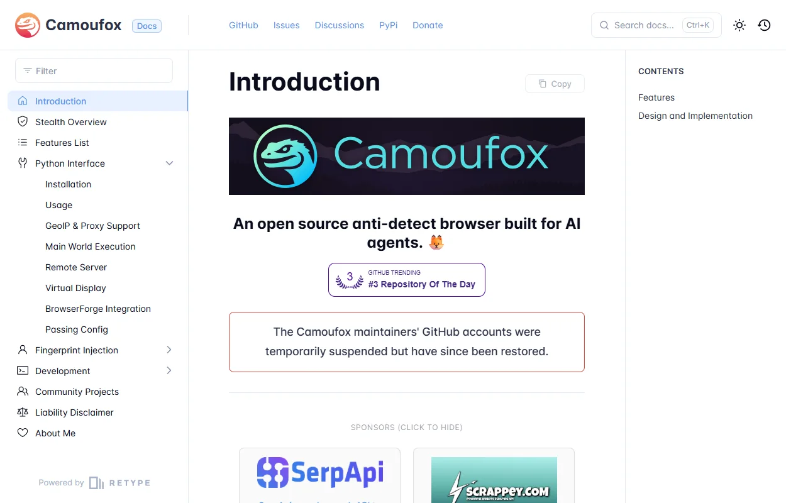
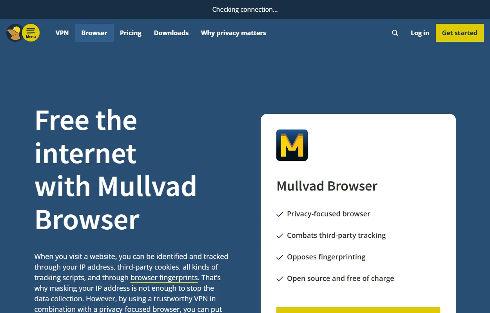

# GitHub 上有哪些开源指纹浏览器？

「指纹浏览器」的中文使用教程和产品源代码是两类资料。在 GitHub 找开源项目时，先看仓库是否提供代码、构建说明和许可证。仅有下载安装链接或产品榜单的仓库，不能据此判定软件已经开源。
[官方资料](https://zwbrowser.com/download/)

## 两个方向不同的项目

**Camoufox** 面向需要程序化浏览器的开发者。若你的任务是自有网站兼容性测试，应先核对支持的系统、语言接口和当前维护情况。[Camoufox 项目](https://github.com/daijro/camoufox)

**Mullvad Browser** 面向减少浏览时的跟踪和指纹识别。它适合研究浏览器隐私保护，需求如果是给客服分配店铺，要另行检查团队、环境列表与交接功能。[Mullvad Browser 项目](https://github.com/mullvad/mullvad-browser)

## 下载前看哪三处？

在 README 确认用途，到 Releases 看最近发布的版本与适配系统，打开 LICENSE 核对你计划的使用方式。由维护者链接到的官网或发布页获取软件，并保留版本号，复测时就能找到同一版本。
